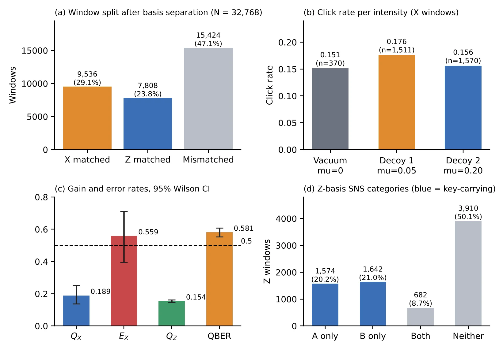
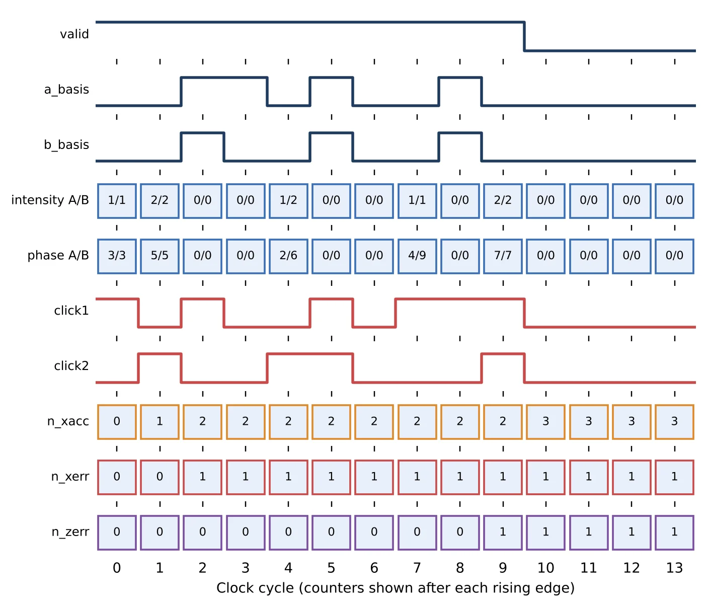

This is the write-up of my B.Tech micro project with [Aayush Gupta](../projects/#sns-micro). It grew out of the OptiSystem prototype I built during my [DRDO internship](../post/#optisystem-sns-tf-qkd-prototype-and-post-processing), and asks a narrower question: the classical chain between a twin-field QKD link and a key-rate number is long, so which parts of it are really just counters, and could they live in an FPGA? Technical stuff first. How the five months really went is at the end, so skip down if that's what you're here for.

The full report, the slides and the poster are on the [Publications page](../publications/#reports), and the code is in the [snstfqkd-fpga repository](https://github.com/Anand-Ambastha/snstfqkd-fpga). The report has a DOI if you want to cite it: [10.5281/zenodo.24390550](https://doi.org/10.5281/zenodo.24390550).

## The idea

Between the physical protocol and a key-rate plot sits window logging, basis sifting, phase post-selection, decoy-state estimation and finite-count statistics. Mistakes in that chain corrupt the rate quietly: one CSV row per waveform sample instead of one per window, or Bob's inverted bit convention copied from Alice.

The first half of the chain is nothing but comparisons and counters applied to a stream of windows. That is what FPGA fabric does well, and what a Python loop does one window at a time. The second half (ratios, logarithms, binary entropy) wants floating point, which the processing side of a PYNQ-style Zynq board gives for free. So the plan was a split: counting in fabric, maths in Python.

## Stage 1: the link, in OptiSystem

Three stations: Alice, Bob and an untrusted Charlie, joined by 40 km spans of SMF-28 at 0.2 dB/km (about 8 dB, a transmittance near 0.158). Each sender has a Z branch that makes the send or not-send decision, and an X branch that picks one of three decoy intensities (vacuum, 0.05, 0.20) and a random phase, quantised into 16 slices. OptiSystem has no block for "send with probability ε", so each protocol step is a MATLAB co-simulation block acting as a programmable tap.

The part that took longest was the logging, not the optics. Every station writes a CSV keyed to one common window index. Windows with no click still get a row with both click flags at zero, because the gain denominator needs the true window count. Skipping them makes the gains look better than they are.

## Stage 2: the Python pipeline

One linear script, every quantity tied to a numbered equation of Wang, Yu and Hu, no curve fitting, and a 95% Wilson interval on every rate estimated from a finite count. On the 32,768-window run:

| Step | Result |
| --- | --- |
| Basis agrees between Alice and Bob | 52.93% of windows (9,536 X and 7,808 Z) |
| X windows with matching intensity, non-vacuum | 3,081 |
| Accepted by the phase-slice rule | 180 (0.0584, close to the 1/16 expected) |
| Z-basis gain, QZ | 0.1541 |
| Z-basis QBER, EZ | 0.5810 |
| Secret key rate | −0.166 per window |

The key rate is negative, and the report spends a chapter on why. The QBER and the X error rate sit near 0.5, which is what an uncorrelated coin flip gives. Vacuum windows click at 0.151 and decoy-2 windows at 0.156, with overlapping intervals, so the clicks are a noise-like background and not a signal. The rate equation is a difference of two terms: the key term is about 7×10⁻⁵ per window and the error-correction cost is 0.166, a ratio near 2,400. Solving R = 0 shows the Z-basis QBER would need to be below roughly 6×10⁻⁴ even in the best case.

So the dataset is structurally right and physically uncalibrated. The pipeline reports an invalid situation as invalid, and I would rather show that than a flattering number. A calibrated OptiSystem run is the obvious next step.

## Stage 3: the sifter core in Verilog

The sifting and tallying stages became one Verilog module of 62 lines, taking one window per clock. Inputs are the two basis bits, two 2-bit intensity codes, two 4-bit phase slices, the two Z send decisions and the two detector clicks. It works in three stages: register the inputs, evaluate the decisions combinationally (basis match, intensity match, phase-slice match, effective click as the XOR of the two detectors, and the sign of cos(δB − δA) from the 4-bit slice difference, so the wrong-bit rule is applied exactly), then increment 19 counters.

**Verification.** The RTL was exported to a cycle-accurate C++ model with Yosys (CXXRTL) and driven with 32,768 random windows. A separate Python reference model implementing the same rules produced the expected counts. All 19 counters matched exactly. A hand-written ten-window stimulus then showed why they match, one clock edge at a time:

Window 9 is my favourite: both detectors click, so the window is accepted but is not an effective single click, which is the whole difference between two counters.

**Synthesis.** With Yosys for a Zynq-7000 xc7z020, the part on PYNQ-Z2 class boards:

| Resource | Used | Utilisation |
| --- | --- | --- |
| LUTs | 24 | 0.05% |
| Flip-flops | 627 | 0.59% |
| CARRY4 cells | 152 | 1.14% |
| Block RAM / DSP | 0 / 0 | 0% |

The numbers decompose exactly. The 627 flip-flops are 608 counter bits (19 counters × 32) plus 19 input-register bits, and the 152 carry cells are 8 per counter. Resource use is linear in counter width: flip-flops follow 19·CW + 19 while the LUT count stays near 24. At one window per clock, a 32,768-window run takes about 32,770 cycles, which is 0.33 ms at an assumed 100 MHz. That clock is an assumption, not a timing result.

## What is not done

Three things, and the report says so in a table instead of hiding them. The real OptiSystem CSVs have not been run through the RTL (only random stimulus). There is no Vivado place-and-route, timing or power report. And there is no AXI-Lite wrapper, no bitstream and no run on a board. The Verilog is complete and synthesisable, so what is left is mostly tooling and lab time.

## Okay, now the real story

Five months. Three reviews. And a plan that every single time ended with "and then we'll put it on the FPGA."

We didn't. Diwali and the festive weeks came, the lab was shut right when we needed it, and the board never left its box. I'd love to blame only the calendar, but honestly, a good chunk of it was us. We kept saying "there's time" and then it was November. Classic.

Working with Aayush is the best part of this whole project, and also the hardest. He's my Leonard. Calm, always up for the work, never bothered by anything. That's brilliant when a simulation crashes. It's less brilliant when I'm freaking out about a review and he just goes "yeah, it'll be fine." And it was fine. Every time. I still can't decide whether to be grateful or annoyed, so I'm both.

That makes me the difficult one, I guess. I'll take it. For the record, here's how I'd like the project remembered:

- "I'm not procrastinating, I'm letting the problem mature." (The board run, September to November.)
- "The lab is closed for the festival? That's an unacceptable schedule and I'm going to write to someone." (I wrote to nobody.)
- "A negative key rate isn't a failure, it's an honest result about the noise." (Aayush nodded and kept eating.)
- "All 19 counters match the reference model exactly. Applause is optional but encouraged."
- "Three reviews? Three? One review and a nervous stomach used to be enough." (Last year. That was last year.)
- "We'll run it on the board next week." (Said weekly. The board has probably started laughing.)

Aayush's answer to every one of these is "okay." Same voice, every time. Best counter-argument I've ever met, and I have never once won.

If you're doing something like this, my only advice: book the lab early and write the date of your first board run somewhere you can't ignore it. Software waits for you. A closed lab doesn't.

The board run is still on the list and the Verilog is ready for it. If you work on FPGA-side QKD post-processing, or just want to swap notes on those counters, [get in touch](../contact/). The project is on the [Projects page](../projects/#sns-micro).
