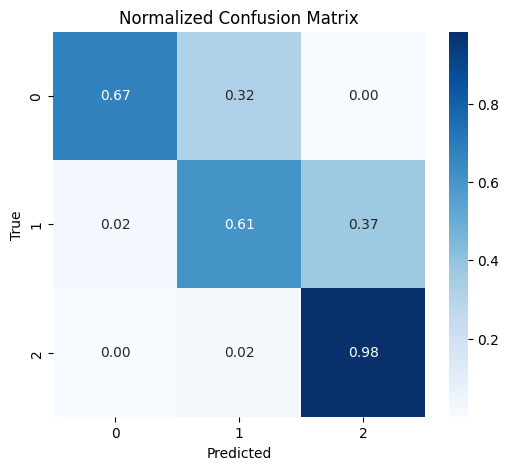
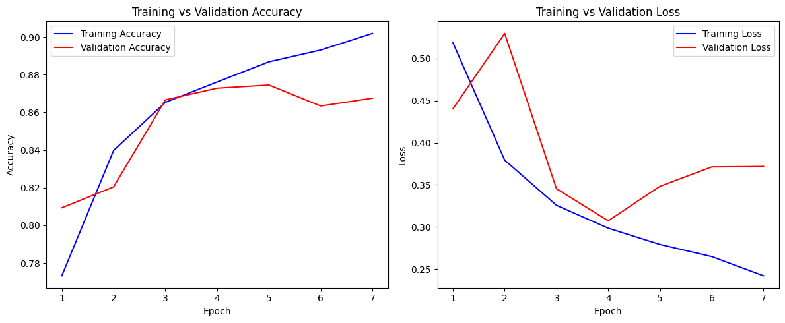

Rice is sensitive to short spells of heat, dry air and high evaporative demand, and farmers decide on irrigation on exactly that timescale. This post describes a course project for CMU 11-785 (Introduction to Deep Learning) in which I built a model that reads 48 hours of weather and labels the stress on the crop as low, medium or high. The harder part was not the model. It was asking whether it still works in a climate it was never trained on. The entry on the [Projects page](../projects/) has the short version, the full write-up is the [project report (PDF)](https://github.com/Anand-Ambastha/CMU-11785-AI-Driven-Paddy-Classifier/blob/main/Project_Report.pdf), and the code is on [GitHub](https://github.com/Anand-Ambastha/CMU-11785-AI-Driven-Paddy-Classifier).

## The data

The weather is hourly, for January 2023 to December 2024, from six places chosen to cover very different rice-growing climates:

| Location | Climate |
| --- | --- |
| Jorhat, Assam | Humid subtropical |
| Ludhiana, Punjab | Semi-arid |
| Lucknow, Uttar Pradesh | Subhumid |
| Kolkata, West Bengal | Humid coastal-monsoon |
| Thanjavur, Tamil Nadu | Tropical wet |
| Visakhapatnam, Andhra Pradesh | Coastal tropical |

With roughly 22,000–24,000 hourly samples per site, each hour is described by temperature, relative humidity, vapour pressure deficit (VPD, derived) and precipitation, together with short-term gradients (change in temperature, RH and VPD), 6 to 12 hour rolling means, and derived indices (heat index and humidity ratio). These features emphasise the short-term transitions that tend to come before stress. Soil moisture sensors were not available, so the model relies on weather-driven atmospheric demand. A window of 48 consecutive hours, moved forward one hour at a time, is one sample. The window length reflects the agronomic idea that stress usually builds over a day or two, not in a single hour.

## There are no field labels, so the labels are built

No dataset tells us, hour by hour, how stressed a paddy field was. So the labels come from rules that come from rice physiology and irrigation practice, applied to each 48-hour window. Two parts are combined.

**Physiology.** Four signals are checked: maximum temperature above 33 °C, minimum relative humidity below 50%, mean vapour pressure deficit (VPD) near or above 2.0 to 2.2 kPa, and a run of consecutive hot hours. Each one that fires adds to a score.

**Atmospheric water deficit.** Over the 48 hours, the labelling rule adds up reference evapotranspiration (ET0) minus rainfall. A deficit from 15 mm up to 40 mm is moderate stress, and 40 mm or more is severe.

The final class follows from both:

- **High:** physiology score of 4 or more, or a deficit of 40 mm or more
- **Medium:** physiology score of 2 or more, or a deficit from 15 to 40 mm
- **Low:** everything else

The fast signals catch heat and dryness as they arrive, and the deficit catches the slower build-up of evaporative demand that temperature alone misses. The cost is plain: these are rule-based labels, so the model learns to reproduce the rules from raw weather, not to match measured crop damage. The report lists this as a limitation.

## The model

The network is small:

1. A **bidirectional LSTM** (64 units) reads the 48 hours in both directions, so it can use both a rising VPD trend and a humidity rebound after rain.
2. A **32-unit LSTM** on top turns those features into one forward-only summary.
3. A **dense softmax layer** gives the three class probabilities.

It is trained with categorical cross-entropy and Adam, a batch size of 64, balanced class weights and early stopping on validation macro-F1. A light **attention** module is attached for analysis only. It does not feed the prediction, so it can show which hours mattered without changing what the classifier learned. The code is TensorFlow and Keras.

## The test that matters: leave one location out

A random split of windows would put hours from the same place, and often the same week, on both sides of the split, and the score would flatter the model. Instead, I trained on five locations and tested on the sixth, which the model never sees. This is the leave-one-location-out (LOLO) protocol. The main run holds out Visakhapatnam, a coastal site where humidity swings quickly, which makes it the hardest case.

| Model | Accuracy | Macro-F1 |
| --- | --- | --- |
| Logistic regression | 66.57% | 0.6636 |
| Random forest | 68.44% | 0.6912 |
| 1-layer LSTM | 71.24% | 0.7128 |
| **BiLSTM-LSTM** | **73.39%** | **0.7368** |

On the held-out site the model also reaches a balanced accuracy of 0.755 and a macro ROC-AUC of 0.924. The ordering of the table is the useful part: each step from linear model to tree ensemble to recurrent network to the two-stage recurrent network helps a little, which supports the idea that the order of the hours carries information.

## Where it works and where it does not

High-stress windows are found almost every time: the recall for that class is 0.9914. The mistakes are mostly between neighbouring classes, and the report points to the coast as the reason. After rain, humidity rebounds and VPD is squeezed into a narrow range, so a mild window and a moderate one look alike. For an irrigation advisory, missing a severe window is the costly error, so that pattern is the more useful of the two possible ones. Even so, the model is not well calibrated: the report gives an expected calibration error of 0.19, and says its probabilities are overconfident.

## What each part contributes

Removing one component at a time, on the same held-out site, gave these accuracies:

| Variant | Accuracy | Change |
| --- | --- | --- |
| Full model | 73.39% | |
| No physiology term | 61.82% | -11.57 |
| No water-deficit term | 65.04% | -8.35 |
| No second LSTM | 67.40% | -5.99 |
| No bidirectional encoder | 69.12% | -4.27 |

The largest drops come from removing the physiology or deficit terms. Because those terms define the labels, this tells us how much the labelling scheme matters to the task as posed, which is not the same as saying the model discovered them. The two architecture changes are worth smaller but consistent gains.

## Reading the attention

Across locations, the attention weights tend to be highest 12 to 24 hours before a stress transition, which is when heat builds up, VPD rises and humidity falls. At Visakhapatnam the weights vary more, and often rise in the early evening, around the peak of evaporative demand. This is a post-hoc view and it is not proof of cause. The report notes that its use is as a sanity check that the model leans on hours that make agronomic sense.

## The training curves

The report trains for up to 50 epochs, with validation performance closely tracking training performance, which indicates limited overfitting. Early stopping typically triggers between epochs 7 and 12, depending on the held-out location. The held-out location scores lower, at 73.39%, and the gap between the two numbers is the cost of moving to a new climate. It is the reason I trust the LOLO number more than the validation curve.

## Limits

- Soil moisture sensors were not available, and the model has no root-zone soil model and no crop-stage information, and rice responds to heat differently at different growth stages.
- The labels are rule-based, not measured, so they may carry a systematic bias.
- Two years of weather includes few extreme events.
- The main result is one held-out location. Holding out the other five in turn would show how stable it is.

The report suggests transformers, stage-aware stress modelling, soil moisture from hydrological models or satellites, extra inputs such as NDVI and canopy temperature, and checks against field observations. This module was designed as one part of a larger agriculture advisory system.

If you work on agricultural forecasting or domain shift, [get in touch](../contact/). My other projects are on the [Projects page](../projects/).
